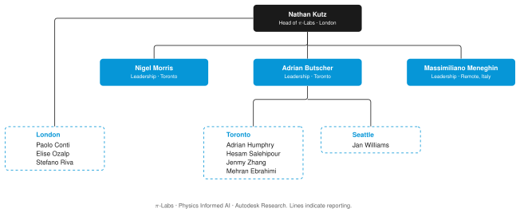

# π-Labs: Physics Informed AI

Welcome to **π-Labs**, the **Physics Informed AI** research group within **Autodesk Research**. We build AI methods that respect the physics of the systems Autodesk customers design and make, from flow, acoustics and thermal effects to structures and urban environments. The plural is deliberate: the group is spread across multiple locations.

    

## About us 🏫

π-Labs is led by **Nathan Kutz** and is part of [Autodesk Research](https://www.research.autodesk.com/). Our work spans scientific machine learning, reduced order modelling, data assimilation, and geometry optimisation and generation, with the goal of putting physics directly in the design loop.

**Head of π-Labs**:

- Nathan Kutz (London Office)

**Leadership**:

- Adrian Butscher (Toronto Office)
- Nigel Morris (Toronto Office)
- Massimiliano Meneghin (remote, Italy)

**Toronto Office**:

- Adrian Humphry
- Hesam Salehipour
- Jenmy Zhang
- Mehran Ebrahimi

**London Office**:

- Paolo Conti
- Elise &Ouml;zalp
- Stefano Riva

**Remote (USA)**:

- Jan Williams

## Research areas 🔍

### Scientific ML for dynamical systems 🌀

### Data assimilation and ML 📡

### Topology and geometry optimisation 📐

### Generative geometry with AI 🧬

### Physics-informed geometry (PIG) 🐷

## Contact us 📬

- **Web:** [Autodesk Research](https://www.research.autodesk.com/)
- **Locations:** London, Toronto, Seattle and remote

